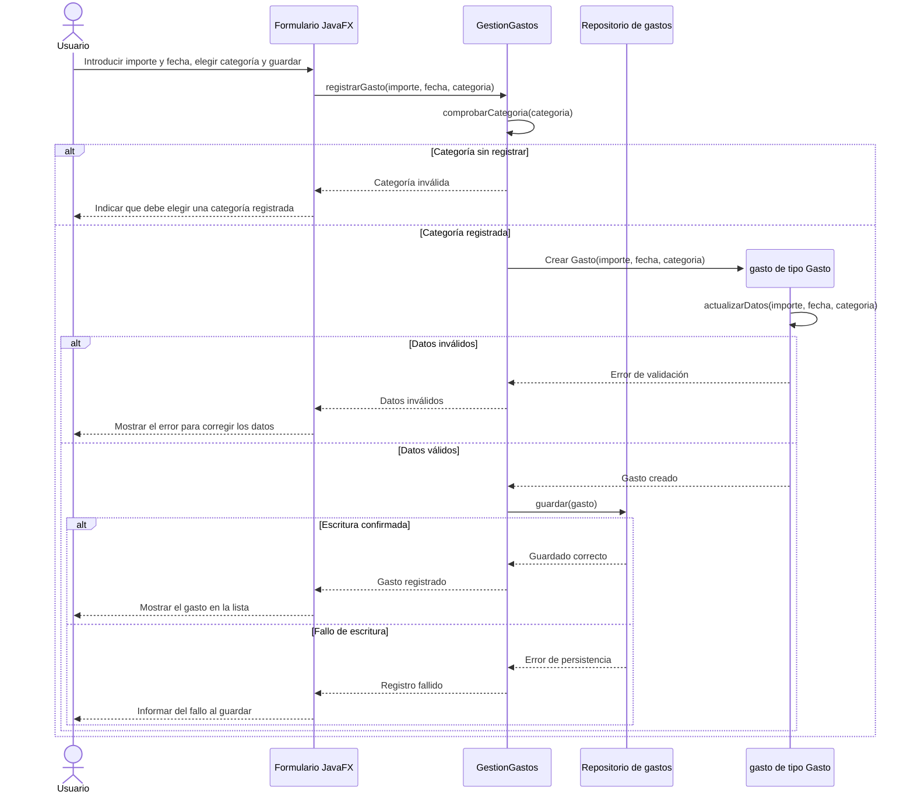

# Diagrama de interacción · HU-01 — Registrar un gasto personal

Como usuario, quiero registrar un gasto con su importe, fecha y categoría para llevar un control de mis gastos.

El diagrama de secuencia UML representa el diseño previsto para el registro desde la interfaz gráfica. Los mensajes se leen de arriba abajo. Los nombres de los participantes indican responsabilidades de diseño y los bloques de alternativas distinguen el resultado de cada validación.

**Precondición.** El usuario ha abierto el formulario y dispone de al menos una categoría registrada.

**Postcondición de éxito.** El gasto queda almacenado con el importe, la fecha y la categoría indicados. Si el usuario cierra y vuelve a abrir la aplicación, puede consultarlo en la lista.

**Comprobación de la HU-01.** Dada la categoría «Transporte», cuando el usuario guarda un gasto de 15 € del 24 de noviembre de 2026, entonces aparece un apunte con esos tres datos y sigue disponible tras reiniciar la aplicación.

**Alcance.** El repositorio representa el contrato de persistencia. Su implementación JDBC solo devuelve éxito tras completar la escritura. La recuperación al reiniciar se comprueba mediante el segundo criterio de [HU-01](historias-de-usuario.md), en una ejecución posterior.
