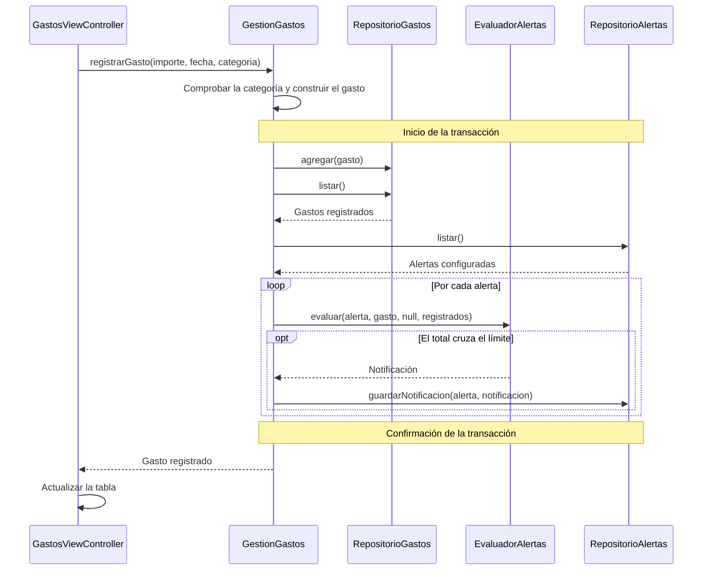

# Diagrama de interacción · HU-01 — Registrar un gasto personal

Como usuario, quiero registrar un gasto con su importe, fecha y categoría para llevar un control de mis gastos.

**Precondición.** El usuario ha abierto el formulario y dispone de al menos una categoría registrada.

**Validación.** El controlador comprueba que la categoría esté registrada. El constructor de `Gasto` valida los datos del apunte. Si algún dato es inválido, la vista muestra el error y el alta se interrumpe antes de escribir en el repositorio.

**Postcondición.** El gasto y los avisos que haya generado quedan guardados en la misma transacción. Si falla una escritura en SQLite, se revierten los cambios de esa operación.

**Comprobación de la [HU-01](historias-de-usuario.md).** Al registrar un gasto de 15 € del 24 de noviembre de 2026 en «Transporte», la tabla muestra el importe, la fecha y la categoría. El apunte se conserva al volver a abrir la aplicación.
