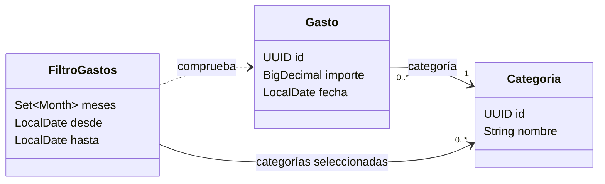
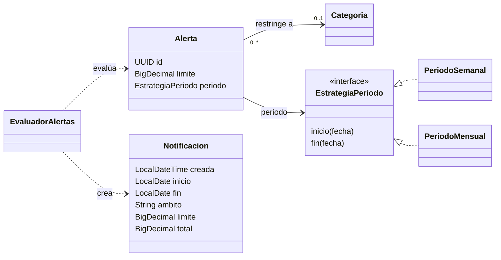

# Modelo de dominio · Gestión de Gastos

## Diagrama de clases del dominio

### Gastos personales y filtros

Cada gasto pertenece a una categoría y una categoría puede aparecer en muchos gastos. Un filtro puede seleccionar varios meses y categorías, y sus dos fechas límite son opcionales e inclusivas. Si se seleccionan varios criterios, el gasto debe cumplirlos todos.

Por ejemplo, un gasto de 12 € en Transporte del 24 de noviembre cumple un filtro de noviembre y Transporte. La flecha discontinua indica que el filtro recibe un gasto para comprobarlo. `GestionGastos` coordina estas operaciones desde la capa de aplicación y aparece en el diagrama de interacción.

### Alertas y notificaciones

La alerta define un límite semanal o mensual. Puede aplicarse al total general o a una categoría concreta. Las notificaciones se generan al superar el límite y forman el historial consultable. `Categoria` representa el mismo concepto que en el primer dibujo.

La tabla de notificaciones vincula cada aviso a su alerta mediante `alerta_id`. El historial se ordena desde el aviso más reciente y construye el texto a partir de los datos guardados.

El comportamiento de registro se especifica en el [diagrama de secuencia de la HU-01](diagrama-interaccion-hu01.md).
