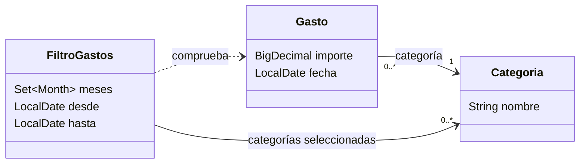
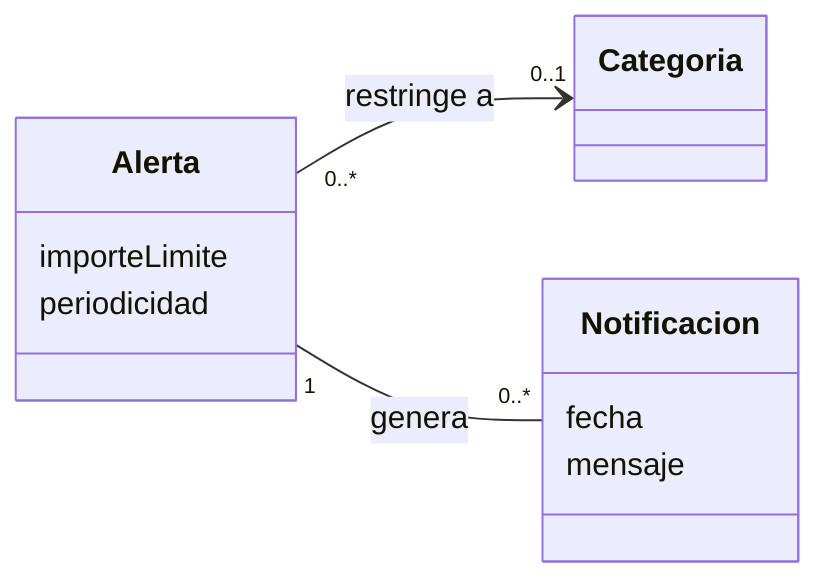
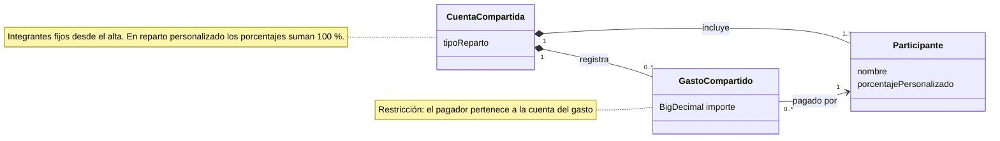

# Modelo de dominio · Gestión de Gastos

## Diagrama de clases del dominio

### Gastos personales y filtros

Esta parte recoge las clases de `modelo` que ya existen. Cada gasto pertenece a una categoría y una categoría puede aparecer en muchos gastos. Un filtro puede seleccionar varios meses y categorías, y sus dos fechas límite son opcionales e inclusivas. Si se seleccionan varios criterios, el gasto debe cumplirlos todos.

Por ejemplo, un gasto de 12 € en Transporte del 24 de noviembre cumple un filtro de noviembre y Transporte. La flecha discontinua indica que el filtro recibe un gasto para comprobarlo. `GestionGastos` coordina estas operaciones desde la capa de aplicación y aparece en el diagrama de interacción.

### Alertas y notificaciones

Propuesta de dominio basada en el enunciado. La alerta define un límite semanal o mensual. Puede aplicarse al total general o a una categoría concreta. Las notificaciones se generan al superar el límite y forman el historial consultable. `Categoria` representa el mismo concepto que en el primer dibujo.

### Cuentas compartidas

Propuesta de dominio basada en el enunciado. La lista de participantes queda fijada al crear la cuenta. Cada gasto se registra con un pagador de esa cuenta. El reparto es igualitario o por porcentajes personalizados que suman el 100 %. El saldo de cada participante se calcula restando a lo que ha pagado la parte que le corresponde.

El rombo negro indica que los participantes y los gastos de este dibujo pertenecen a una cuenta concreta. Se usa `1..*` porque el enunciado no fija un mínimo explícito. `GastoCompartido` se modela por separado porque el enunciado le exige cuenta y pagador, y no le asigna expresamente una categoría.

**Comprobación del modelo.** Si Raquel adelanta 30 € en una cuenta de tres personas con reparto equitativo, cada una asume 10 €. Los saldos son +20 €, −10 € y −10 €. Su suma es cero: todo importe pendiente de cobro tiene su contrapartida en el grupo.

El comportamiento de registro se especifica en el [diagrama de secuencia de la HU-01](diagrama-interaccion-hu01.md).
