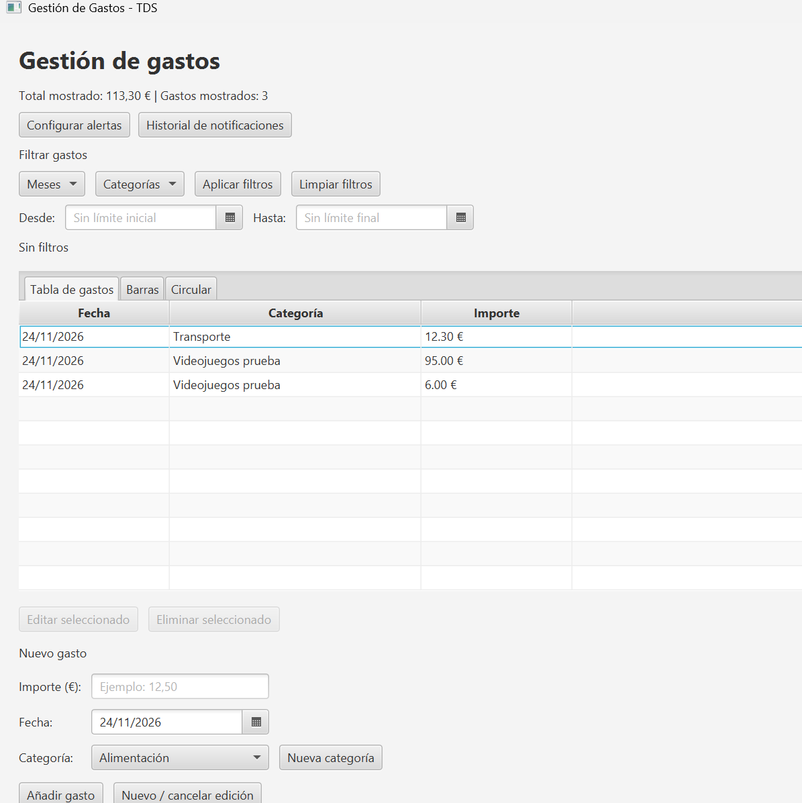
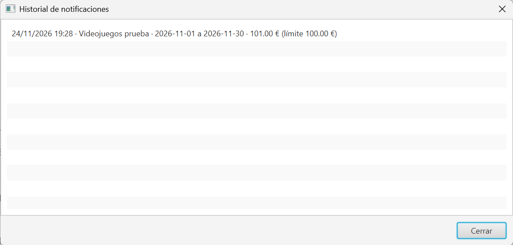

# Manual de usuario

## Registrar y consultar gastos

En la parte inferior de la ventana, escribe el importe en euros, elige una fecha y selecciona una categoría. Pulsa **Añadir gasto**. Para crear una categoría, pulsa **Nueva categoría** e introduce su nombre. Para modificar un apunte, selecciona su fila, pulsa **Editar seleccionado**, cambia los datos y guarda. **Eliminar seleccionado** permite borrar el apunte tras confirmar la operación.

Selecciona meses o categorías, o indica las fechas **Desde** y **Hasta**, y pulsa **Aplicar filtros**. La cabecera indica el total y el número de gastos de la consulta. Las pestañas **Barras** y **Circular** muestran los importes agrupados por categoría. **Limpiar filtros** recupera la consulta completa.

## Configurar una alerta

Pulsa **Configurar alertas**, introduce el límite y selecciona la periodicidad semanal o mensual. Mantén marcada **Todas las categorías** para controlar el gasto general. Para controlar una sola, desmarca la casilla y elige la categoría. Pulsa **Crear alerta**.

## Consultar un aviso

Abre **Historial de notificaciones**. En la imagen, los dos gastos de Videojuegos prueba suman 101 € en noviembre. El total supera el límite mensual de 100 € y genera un aviso. Los 12,30 € de Transporte quedan fuera de esa alerta. El historial conserva la notificación al cerrar y volver a abrir la aplicación.

## Usar la consola

Ejecuta `ConsolaGastos` y escribe el número de la opción. Utiliza **1** para consultar los gastos, **2** para dar de alta, **3** para modificar y **4** para eliminar. Las opciones **5** y **6** permiten listar y crear categorías. La opción **0** cierra la consola. La ventana JavaFX puede consultar los gastos guardados desde este menú.
